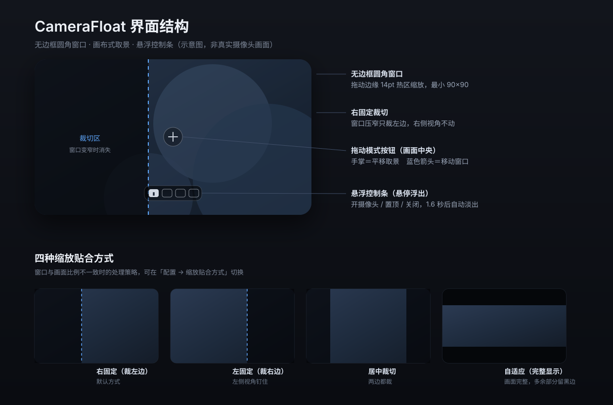

# CameraFloat · 摄像头悬浮窗

[](https://github.com/Zzy010601/CameraFloat/releases/latest)
[](LICENSE)
[](#环境要求)

一个常驻桌面的摄像头悬浮窗工具：无边框圆角小窗，可以任意缩放、画布式拖动取景、左右镜像，随时开关摄像头。提供两个版本：

- **macOS 原生版**：Swift + Cocoa + AVFoundation，零依赖，编译产物不到 200 KB
- **Windows 版**：Python + PySide6，跨平台（macOS / Linux 也能跑）

适合用来当「后视镜」盯右后方、看门口，或者只是想把自己挂在屏幕角落。

<p align="center">
  
</p>

## 直接下载

不想自己编译的话，去 [Releases](https://github.com/Zzy010601/CameraFloat/releases/latest) 下现成的包：

| 平台 | 文件 | 说明 |
|---|---|---|
| macOS | `CameraFloat-macOS.zip` | 解压后拖进「应用程序」。未公证，首次打开需右键 → 打开 |
| Windows | 暂无预编译包 | 用仓库里 `windows\run.bat` 一键运行，或 `build.bat` 自己打包 |

```bash
# 如果 macOS 提示「无法验证开发者」
xattr -dr com.apple.quarantine /Applications/CameraFloat.app
```

## 功能

| 能力 | 说明 |
|---|---|
| **无边框悬浮窗** | 圆角半透明边框，可拖到任意位置，尺寸 90×90 ～ 1600 宽自由缩放 |
| **画布式取景** | 直接拖动画面平移视角，滚轮 / 双指捏合以光标为锚点放大 1～6 倍 |
| **四种贴合方式** | 右固定（裁左）／左固定（裁右）／居中裁切／自适应（完整显示留黑边） |
| **镜像** | 开启即后视镜效果，画面左右翻转 |
| **多摄像头源** | 内置摄像头、外接 USB 摄像头、iPhone 连续互通相机，热插拔自动刷新 |
| **随时开关** | 一键暂停 / 恢复采集，关闭时保留小窗占位仍可拖动 |
| **可切换置顶** | 默认不置顶，需要时一键钉在最上层 |
| **状态记忆** | 窗口位置尺寸、缩放倍数、取景偏移、镜像、置顶、拖动模式全部持久化 |
| **菜单栏常驻** | 菜单栏相机图标可随时唤回窗口、切换配置、退出 |
| **快捷键** | 空格开关摄像头、`Esc` 隐藏、`⌘0` 重置取景、`⌘W` 隐藏、`⌘Q` 退出 |

## 环境要求

**macOS 原生版**

- macOS 13.0 或更高
- Xcode Command Line Tools（提供 `swiftc`）

如果没有安装命令行工具：

```bash
xcode-select --install
```

**Windows 版**

- Windows 10 / 11
- Python 3.9+（安装时勾选「Add Python to PATH」）

## 构建与运行

### macOS

```bash
git clone https://github.com/Zzy010601/CameraFloat.git
cd CameraFloat
./build.sh
open CameraFloat.app
```

首次启动系统会请求摄像头权限，必须点「允许」才有画面。若之前误点了拒绝，窗口内会显示「打开系统设置」按钮，可直接跳转到隐私设置。

安装到应用程序目录（可选）：

```bash
cp -R CameraFloat.app /Applications/
```

想开机自启：系统设置 → 通用 → 登录项 → 添加 `CameraFloat.app`。

### Windows

```bat
git clone https://github.com/Zzy010601/CameraFloat.git
cd CameraFloat\windows
run.bat
```

`run.bat` 首次运行会自建虚拟环境并安装依赖，之后直接启动。也可以手动运行：

```powershell
cd windows
python -m venv .venv
.venv\Scripts\pip install -r requirements.txt
.venv\Scripts\pythonw camera_float.py
```

打包成免安装 exe（需要 PyInstaller）：

```bat
cd windows
build.bat
```

产物在 `windows\dist\CameraFloat\`，整个文件夹可整体拷贝分发。开机自启：把 exe 快捷方式放进 `Win+R` → `shell:startup` 目录。

## 使用方式

窗口内的鼠标操作取决于当前「拖动模式」（画面中央那个圆形按钮控制）：

| 操作 | 效果 |
|---|---|
| 拖动画面（手掌模式） | 平移取景视角，窗口不动 |
| 拖动画面（窗口模式） | 移动整个窗口 |
| `⌘`（mac）/ `Ctrl`、`Alt`（win）+ 拖动 | 任何模式下都临时移动窗口 |
| 滚轮 / 双指捏合 | 以光标位置为中心缩放画面（1～6 倍） |
| `⌘` / `Ctrl` + 滚轮 | 缩放窗口本身 |
| 拖动窗口四边 / 四角 | 调整窗口大小（12～14pt 热区，光标自动变化） |
| 双击画面 / `⌘0` / `Ctrl+0` | 复位取景（缩放 1.0、右对齐） |
| 右键（Windows 版） | 打开配置菜单 |

配置入口：macOS 在应用菜单栏的 **配置** 菜单 + 菜单栏相机图标菜单（两处同步）；Windows 在托盘图标菜单 + 窗口右键菜单。

- **摄像头源** ▸ 内置 / 外接 / 连续互通相机（macOS）/ 虚拟摄像头
- **镜像画面（后视镜）**
- **缩放贴合方式** ▸ 右固定 / 左固定 / 居中裁切 / 自适应
- **拖动模式** ▸ 拖动画面视角 / 拖动整个窗口
- **重置取景**、**置顶**、**重置窗口大小**

更细的说明见 [docs/USAGE.md](docs/USAGE.md)。

## 「后视镜」怎么用

内置摄像头的物理位置固定在屏幕顶端、只朝正前方，**软件无法让它转头拍身后**。想真正盯右后方，需要换摄像头源：

1. iPhone 升级到 iOS 16+，与 Mac 登录同一 Apple ID、连同一 Wi-Fi、两边蓝牙都打开
2. 把 iPhone **横放、锁屏、固定不动**（支架或夹在椅背 / 书架上），镜头朝右后方——连续互通相机只在锁屏静止时自动上线
3. 在「配置 → 摄像头源」里选择你的 iPhone
4. 保持镜像开启，就是标准后视镜观感

延迟约 0.1～0.2 秒，看身后有没有人过来完全够用。若不方便用 iPhone，也可以买一个能转头的 USB 摄像头夹在笔记本侧边。

## 隐私

- 画面只在本地渲染，**没有任何网络请求**，两个版本的代码里都没有网络相关 API
- 不写入任何数据文件，配置只存在系统偏好（macOS `UserDefaults` / Windows 注册表 `HKCU\Software\CameraFloat`）
- 摄像头采集完全交给系统框架（AVFoundation / Qt Multimedia），系统级「视频效果」（人像、人物居中、回应等）会叠加在画面上

## 项目结构

```
.
├── Sources/main.swift          # macOS 版全部实现（Swift，单文件）
├── Resources/
│   ├── Info.plist              # 应用信息与摄像头权限说明
│   └── AppIcon.icns            # 应用图标
├── tools/makeicon.swift        # 图标生成脚本（可选）
├── windows/                    # Windows / 跨平台版（PySide6）
│   ├── camera_float.py         # 主程序
│   ├── run.bat                 # 一键运行（自动建虚拟环境）
│   ├── build.bat               # 打包为免安装 exe
│   └── requirements.txt
├── docs/
│   ├── USAGE.md                # 详细使用文档
│   └── preview.svg             # 界面示意图
└── build.sh                    # macOS 一键构建
```

## 常见问题

**为什么点一下小窗，左上角菜单栏就变成「CameraFloat」？**
这是 macOS 对常规应用（有 Dock 图标）的固定行为，无边框窗口也绕不过。如果更希望它是纯辅助工具——不占 Dock、不进 `⌘Tab`、不抢菜单栏——把 `Sources/main.swift` 末尾的 `app.setActivationPolicy(.regular)` 改成 `.accessory`，并在 `Resources/Info.plist` 里加一行 `<key>LSUIElement</key><true/>`，重新构建即可。

**控制中心「视频效果」面板里显示的是系统默认图标？**
那是控制中心对早期版本图标的缓存，不影响功能。程序坞和 `⌘Tab` 里的图标是正常的。

**内置摄像头能拍右后方吗？**
不能，物理朝向固定。见上文「后视镜怎么用」。

**画面被裁得很厉害，怎么恢复？**
菜单里「重置取景」或 `⌘0` / `Ctrl+0`，或把「缩放贴合方式」改成「自适应（完整显示）」。

**Intel Mac 能编译吗？**
`build.sh` 会按当前机器架构自动选择编译目标，Intel 机器直接 `./build.sh` 即可。

**Windows 版双击 `run.bat` 没反应？**
用命令行跑 `python camera_float.py` 看报错。常见原因是 Python 没加入 PATH，或缺少 PySide6（`python -c "import PySide6"` 可自检）。另外确认 系统设置 → 隐私和安全性 → 相机 里已允许桌面应用访问相机。

**Windows 版和 macOS 版功能一样吗？**
一致，差异只在快捷键（`⌘` vs `Ctrl`）和交互细节，详见 [docs/USAGE.md](docs/USAGE.md) 末尾的对照表。

## License

[MIT](LICENSE)
